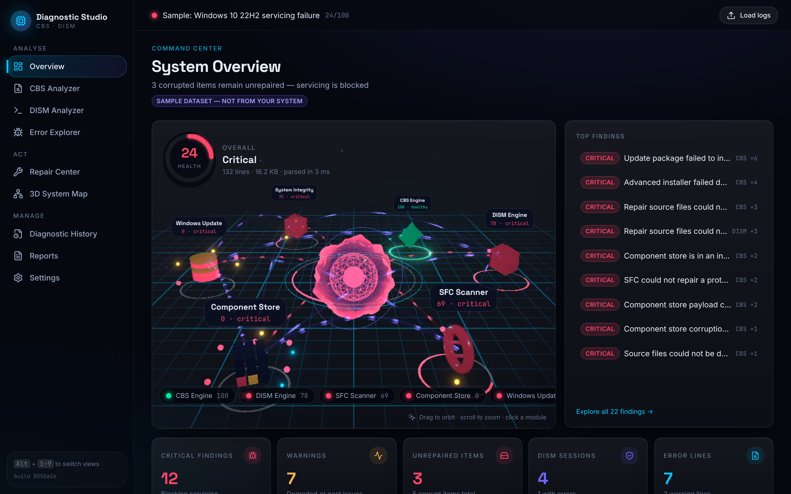
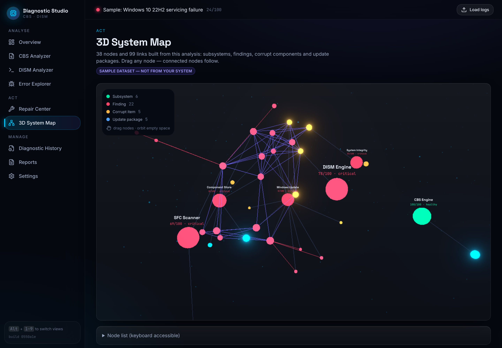
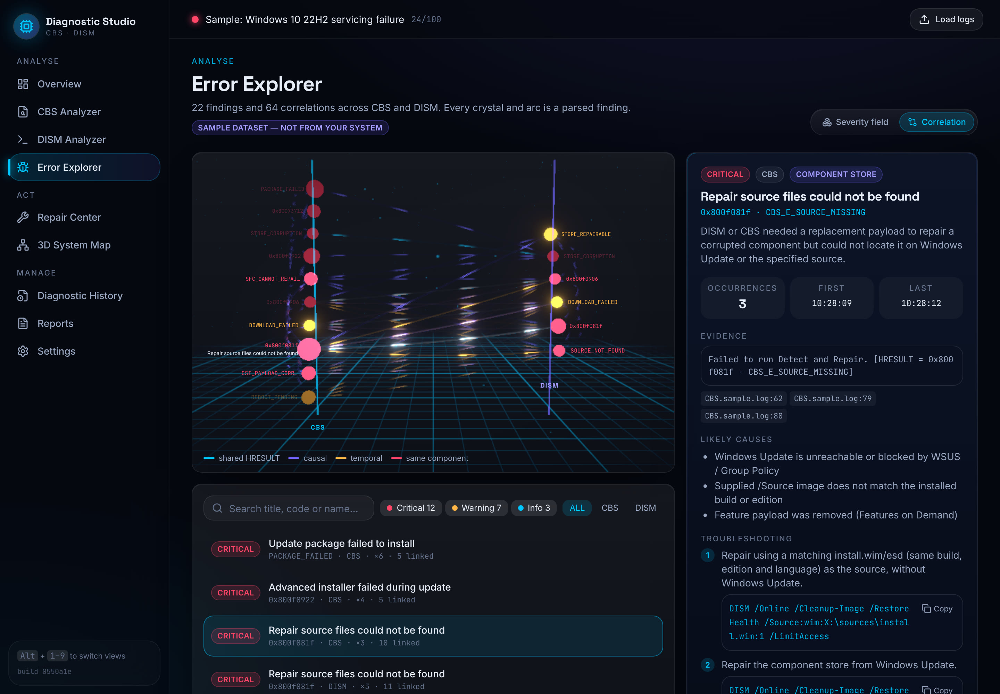
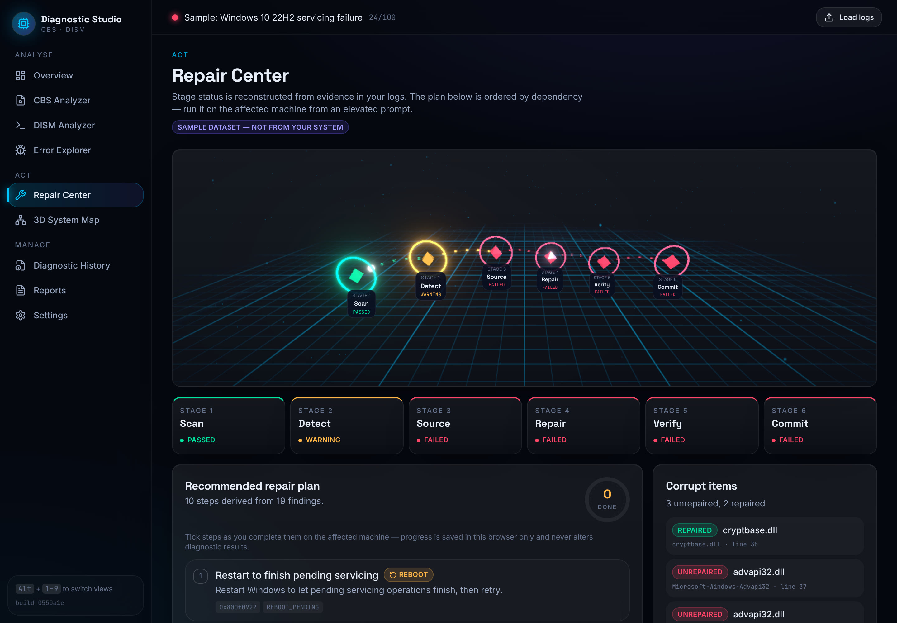

# CBS & DISM Diagnostic Studio

An immersive, local-first analyser for Windows servicing logs (`CBS.log`, `dism.log`).

**Live site: https://prajwalstark.github.io/CBS-DISM-logs/**









Logs are parsed **in your browser** inside a Web Worker. Nothing is uploaded.

Every number, colour and 3D object in the interface comes from parsed log data. When no
logs are loaded, the UI says so rather than showing placeholder results. A sample dataset
is included for demos, and it is always labelled *"Sample dataset — not from your system"*.

## Quick start

```bash
npm install
npm run dev          # http://localhost:5173
```

```bash
npm run build        # type-check + production build into dist/
npm test             # engine unit tests (vitest)
npm run e2e          # headless Chromium end-to-end suite (needs a build first)
```

## Deployment

Pushing to `main` runs `.github/workflows/deploy-pages.yml`: tests, a build with `VITE_BASE=/<repo>/`, and a deploy to GitHub Pages. The live site is https://prajwalstark.github.io/CBS-DISM-logs/, and its sidebar footer (or Settings on mobile) shows the deployed commit. In the repo's Settings → Pages, **Source** must be set to **GitHub Actions**.

## Features

| Page | What it does |
|---|---|
| **Overview** | 3D system core with six subsystem nodes (CBS, DISM, SFC, Component Store, Windows Update, System Integrity). Drag to orbit, scroll or pinch to zoom, click a node to fly to it and open its panel. Also shows KPIs, an interactive diagnostic timeline and the top findings. |
| **CBS Analyzer** | Files, severity mix, HRESULT breakdown, SFC runs, checker summaries, TrustedInstaller sessions, update packages, timeline, and a virtualised log viewer with search and filters. |
| **DISM Analyzer** | DISM sessions (command, operation, `/Source`, component-store state, result, reboot), timeline and log viewer. |
| **Error Explorer** | A 3D severity crystal field and a 3D CBS↔DISM correlation bridge, alongside a filterable findings list. Each finding shows its evidence, line references, likely causes, troubleshooting steps with copyable commands, Microsoft documentation links and correlated errors. |
| **Repair Center** | A 3D six-stage repair pipeline (Scan → Detect → Source → Repair → Verify → Commit) whose stage statuses are reconstructed from log evidence. Also a dependency-ordered repair plan with a checklist (saved in this browser only) and the list of corrupt items. |
| **3D System Map** | A force-directed graph of subsystems, findings, corrupt components and packages. Drag any node and its connected nodes follow. |
| **Diagnostic History** | Analyses saved in IndexedDB, a health trend chart, and open / delete / clear. |
| **Reports** | Export as HTML (self-contained, script-free, printable), Markdown, CSV (formula-injection safe) or JSON. |
| **Settings** | 3D quality tier, 3D on/off, bloom, particles, auto-rotate, reduced motion, auto-save. |

## How the diagnosis works

- **Parsing** (`src/engine/analyzer.ts`): a streaming, line-by-line state machine.
  - Handles the timestamped `YYYY-MM-DD HH:MM:SS, Level Component Message` grammar.
  - Untimestamped continuation lines (the checker `Summary:` block and `(p) CSI Payload Corrupt` rows) inherit their context.
  - Reads UTF-8 and UTF-16 (BOM-sniffed).
- **Detection**:
  - HRESULTs in `[HRESULT = 0x… - NAME]`, `hr:0x…` and bare `HRESULT=800F081F` forms.
  - SFC `[SR]` repairs and failures, CSI payload corruption and its repair outcome, checker totals.
  - DISM sessions, operations and store state; package states; reboot or pending transactions; download failures; low disk; cleanup recommendations.
- **Knowledge base** (`src/engine/knowledge.ts`): documented HRESULTs and log patterns, each with causes, remediation and Microsoft Learn / Support links. Unknown codes are decoded by facility (Win32, CBS, WU).
- **Findings** are kept per source, so the same HRESULT reported by both CBS and DISM shows up as two linked findings.
- **Correlations**: shared HRESULT, causal rules (for example *source missing → payload unrepaired*), temporal co-occurrence across CBS and DISM within 120 s, and the same corrupt file appearing in both SFC and CSI.
- **Health scores** are explainable: each module panel lists the exact penalties ("Score derivation"). A code that both logs report counts again at half weight.

## Performance

- Parsing runs in a Web Worker with streamed reads and throttled progress updates. Memory stays bounded: only notable lines (capped) and aggregates are kept.
  Measured in headless Chromium: **150 MB CBS.log parsed in about 4 s, with a 21 MB JS heap afterwards**.
- three.js, React Three Fiber and postprocessing load **only when a 3D scene is shown**. The initial JS is about 150 KB gzipped.
- Rendering is on demand:
  - full frame rate while you interact;
  - about 20 fps when idle;
  - paused when the scene is off-screen or the tab is hidden;
  - static under reduced motion.
- Quality tiers (auto-detected, refined at runtime with `PerformanceMonitor`):
  - *high*: N8AO, MSAA, bloom;
  - *medium*: bloom;
  - *low*: no post-processing, fewer particles.
- Repeated objects use instanced meshes. Geometries created outside JSX are disposed explicitly.
- Labels are projected imperatively (`three/Label3D.tsx`) instead of one React root per label.
- If WebGL is unavailable or disabled, every scene falls back to an interactive 2D SVG equivalent.

## Accessibility

- Skip link, visible focus rings, and `Alt+1…9` to switch pages.
- Every 3D scene has a keyboard-operable DOM equivalent (module toolbar, findings list, node list, stage buttons, timeline event list).
- `prefers-reduced-motion` is respected, and you can override it in Settings.

## Project layout

```
src/engine/     parsing, knowledge base, aggregation, reports (pure TS, unit-tested)
src/workers/    Web Worker + streaming file reader
src/three/      R3F scenes, GLSL shaders, camera rig, labels
src/fallback/   2D SVG fallbacks
src/components/ shared UI (shadcn/ui primitives in components/ui)
src/pages/      routed pages
e2e/            Playwright end-to-end suites
```

## Notes

- `CbsPersist_*.cab` archives must be extracted before loading.
- The Microsoft documentation links point to stable Learn / Support pages, but the build environment could not reach them to check they resolve.
